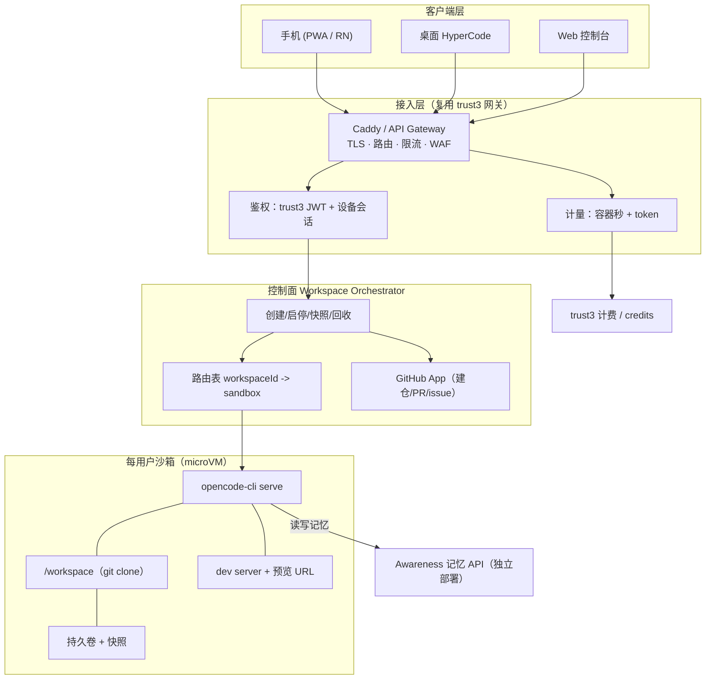
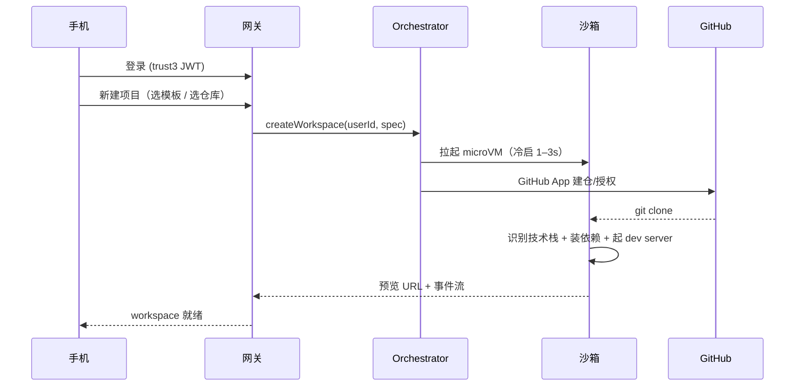
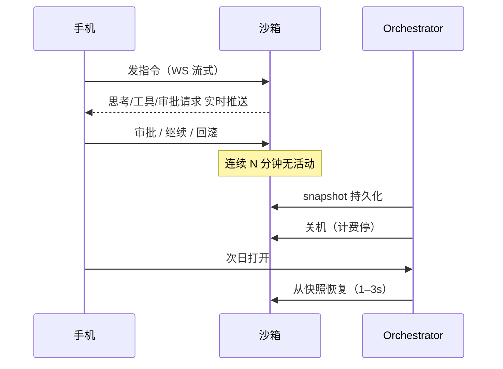

# HyperCode 云端 · 手机全服务 · 架构 / 成本 / 选型（v1 草案）

> 状态：**待评审（不动代码）**
> 日期：2026-10-27
> **修订（2026-10-27，按老板决策）**：计算层改为**自建**（用自有云 + gVisor/Firecracker 做强隔离）；**GitHub 降为可选**，版本管理/项目管理全部内置（传统客户不会搞 GitHub）。最新执行方案见 `cloud-mobile-p0-plan.md`（v1.1）。
> 关联：`docs/PRD.md`、`docs/private-deployment.md`、`docs/mas-sandbox-risks.md`、`docs/产品与定价单.md`、`docs/模型接入与计费.md`
> 一句话：把 agent 的**执行**放云端沙箱，手机只是**任务中心 + 审阅**的瘦客户端。

---

## 0. TL;DR（一页纸）

| 结论 | 说明 |
|---|---|
| **做云端全服务，不做"遥控桌面"** | 遥控要求电脑常开/无 NAT/不睡眠，且不可分享；云端才能"随时、多人、持久" |
| **计算层与记忆层分离** | **不要**把用户可执行代码的沙箱塞进 Awareness 那台 Vultr（单点、串扰、逃逸会伤及记忆服务） |
| **沙箱用托管 microVM 起步** | E2B / Daytona 类（Firecracker，天然强隔离 + 快照 + scale-to-zero + 按秒计费），不在一台 VPS 上硬扛 |
| **后端几乎不用重写** | `@opencode/cli` 已有 `serve` + HTTP/WS API；每用户容器跑一个 `opencode-cli serve`，网关按 workspaceId 路由 |
| **手机端 PWA 先行** | 复用现有 Vue/session-ui；免商店审核、即时更新、绕开 iOS IAP 卖订阅 |
| **成本命门是"闲置"** | 24/7 常开 ≈ **$43/用户/月**；scale-to-zero ≈ **$2/用户/月**，差 **~20 倍** |

---

## 1. 背景：为什么现在做

PRD §2.1 的六大痛点里，**P1（封号/限流/断供）、P3（长时自主）、P4（折腾成本）、P5（黑盒不透明）、P6（记忆不持久）**，本质上都能被"云端常驻 workspace + 记忆 + 可观测"直接缓解：

| PRD 痛点 | 云端全服务怎么解 |
|---|---|
| P1 封号/断供 | 模型在服务端统一接入 + 多路 failover（trust3 已有），用户端零配置 |
| P3 长时自主 | 沙箱 7×24 常驻，手机可关；任务在云端跑完推通知 |
| P4 折腾成本 | 开箱即用的云端 workspace，免装环境/插件 |
| P5 黑盒 | 云端可观测：实时事件流、diff、预览、审批 |
| P6 记忆不持久 | Awareness 记忆 API 挂到 workspace 上，项目级长期记忆 |
| **MAS 沙盒风险** | App Store 版**不跑本地进程**（`mas-sandbox-risks.md` 的死结），执行全在云端 → 反而绕开上架风险 |

---

## 2. 关键判断

### 2.1 为什么"云端全服务" > "遥控桌面"
- 遥控：桌面必须开机、不休眠、公网可达（NAT/防火墙/动态 IP），断网即废；多人协作不可行；安全边界在用户机器上，出事难兜底。
- 云端：手机随时接入，会话可持久、可分享、可团队协作，执行环境可控可审计。
- 折中：云端为默认；**企业版**可"接入自建 runner"（私有化，见 `private-deployment.md` 的 baseURL 思路）。

### 2.2 为什么**不能**直接跑在 Awareness 服务器上
| 问题 | 后果 |
|---|---|
| 单机无强隔离 | 用户 agent 可跑任意 shell/联网，普通容器逃逸风险高 |
| 串扰 | 一个用户跑满 CPU/磁盘，拖垮同机所有人和记忆服务 |
| 爆炸半径 | 沙箱被攻破 → 直连 Awareness 记忆数据 |
| 运维耦合 | 记忆服务的稳定性被计算负载绑架 |

> 正解：**计算 = 独立沙箱池；记忆 = Awareness 仅通过 HTTP 内网调用**。

---

## 3. 总体架构

### 3.1 分层职责
| 层 | 组件 | 复用/新建 |
|---|---|---|
| 客户端 | 手机 PWA、桌面、Web | 复用 `packages/app`、`packages/session-ui`、`packages/sdk`；新建移动端 |
| 接入 | Caddy + trust3 JWT + 计量 | 复用 trust3 网关/计费 |
| 控制面 | Workspace Orchestrator | **新建**（核心工作量） |
| 沙箱 | `opencode-cli serve` + workspace | 复用 `packages/cli`、`packages/server`、`packages/protocol` |
| 记忆 | Awareness | 复用，独立部署 |
| 代码托管 | GitHub App | **新建**（轻） |

### 3.2 为什么能省掉"自研后端"
`opencode-cli serve` 已经暴露 `/api/session`、`/api/message`、`/api/part`、`/api/event`(流)、`/api/info` 且带鉴权。
→ 云端只需把这条"本地 CLI 服务"搬进沙箱，手机端当成原来的 renderer 用，**协议一致**（`packages/protocol`）。

---

## 4. 核心流程（时序）

### 4.1 首次创建项目

### 4.2 日常使用 / 空闲归档

---

## 5. 用户隔离与安全（生死线）

| 维度 | 要求 |
|---|---|
| 计算隔离 | **每用户一个 microVM**（Firecracker/Kata），非共享内核容器；CPU/内存/磁盘/进程硬配额 |
| 网络 | 独立网络命名空间；**出站域名白名单**（防 SSRF/挖矿/外泄）；禁止跨租户互访 |
| 存储 | 每用户独立卷；快照加密；不挂宿主目录 |
| 密钥 | GitHub token / 模型 key 进 **secret vault**，按会话短期注入，不落盘、不进日志 |
| 代码 | git 凭据用 GitHub App installation token（短时、可撤销） |
| 审计 | 命令、网络、计费全链路可追溯（复用 trust3 ops） |
| 逃逸兜底 | microVM 级隔离，单沙箱被攻破也碰不到他人与记忆库 |

---

## 6. 技术选型对比

### 6.1 沙箱（核心）
评分：5=最好

| 方案 | 隔离强度 | 冷启 | 快照/唤醒 | 按秒计费 | 中国可用 | 运维负担 | 集成成本 | 总分 |
|---|---|---|---|---|---|---|---|---|
| **E2B**（托管 microVM） | 5 | 4 | 5 | 5 | 海外优 | 1 | 5 | **25** |
| **Daytona** | 5 | 4 | 4 | 4 | 海外 | 1 | 4 | 22 |
| **Fly Machines** | 4 | 3 | 4 | 4 | 海外 | 2 | 3 | 20 |
| **Modal**（偏函数/GPU） | 4 | 3 | 2 | 4 | 海外 | 1 | 3 | 17 |
| **Cloudflare Containers** | 3 | 5 | 2 | 4 | 全球边缘 | 1 | 3 | 18 |
| **自建 K8s + gVisor** | 4 | 2 | 3 | 3(自算) | 国内可 | 5 | 2 | 19 |
| **单台 VPS + Docker** | **1** | 5 | 1 | – | 可 | 2 | 5 | **14（不推荐）** |

> **推荐**：P0/P1 用 **E2B**（2 天可接）；国内用户量大或成本敏感时，迁移**阿里云 ACK/腾讯云 TKE + gVisor**（或国内托管沙箱）。

### 6.2 手机客户端
| 方案 | 复用度 | 迭代速度 | 商店成本 | iOS IAP 风险 | 推荐 |
|---|---|---|---|---|---|
| **PWA（Vue 复用）** | 5 | 5 | 0 | 无（web 售卖） | **P0 首选** |
| React Native (Expo) | 3 | 3 | 中 | 有 | P1 |
| Flutter | 1 | 2 | 中 | 有 | 不选 |
| 原生双端 | 0 | 1 | 高 | 有 | 团队大再做 |

### 6.3 其他
| 项 | 选择 | 理由 |
|---|---|---|
| 接入网关 | 复用 **Caddy**（trust3 已有） | 零新增 |
| 鉴权 | **trust3 JWT** + 设备令牌 | 与计费打通 |
| GitHub | **GitHub App**（非 OAuth App / PAT） | 细粒度、可建仓、可开 PR、短时 token |
| 项目管理 | **GitHub Issues/Projects** 起步 + agent 自带 session/todo/plan | 不重造轮子 |
| 持久化 | 卷 + 快照（供应商原生） | 免自建存储 |
| 观测 | 复用 trust3 ops + 事件流 | 一套 |

---

## 7. 成本测算（**估算，单价以官网为准，可替换**）

### 7.1 单价假设
| 项 | 取值（区间） | 备注 |
|---|---|---|
| 活跃沙箱 | **$0.05–0.10 / 活跃小时**（2vCPU/4GB 当量） | 托管 microVM 溢价 |
| 空闲快照存储 | $0.02–0.10 / GB·月，workspace ~2–5GB | 归档态 |
| Token | DeepSeek 量级：长任务 0.1–1M tokens/次 ≈ ¥0.2–3 | 极便宜 |
| 网关/带宽 | 可忽略（复用） | |

### 7.2 关键对比：闲置 vs scale-to-zero（每用户）

| 模式 | 月度成本 | 说明 |
|---|---|---|
| **24/7 常开** | 0.06 × 720 ≈ **$43/月** | **直接亏穿** |
| **scale-to-zero（每天活跃 1h）** | 0.06 × 30 ≈ $1.8 + 快照 $0.3 ≈ **$2.1/月** | 推荐 |
| 差 | **≈ 20×** | 这就是利润生死线 |

### 7.3 分场景月成本（活跃 1h/天 · 含 token）
| 规模 | 沙箱 | 快照 | token | 合计 | 备注 |
|---|---|---|---|---|---|
| 10 用户 | ~$18 | ~$3 | ~$15 | **~$36** | 试水 |
| 100 用户 | ~$180 | ~$30 | ~$150 | **~$360** | ~¥2.6k |
| 1000 用户 | ~$1800 | ~$300 | ~$1500 | **~$3600** | ~¥2.6w |

> 可调参数：活跃时长、规格、单价。**活跃时长是主变量**。

### 7.4 定价与毛利校验（对照现有档位）
现有：Trial ¥30($4.2)/月、Basic ¥79($11)/月、Pro 更高。

| 档位 | 收入 | 云端成本(假设) | 毛利 |
|---|---|---|---|
| Basic ¥79 | $11 | ~$3（含 token） | ~73% ✅ |
| Trial ¥30 | $4.2 | ~$2–3（限额要死） | 30–50%，需限时长 ⚠️ |
| 重用户（每天 6h） | 同上 | ~$13（$0.06×180+token） | **亏** ❌ → 需超量计费 |

> 结论：**"充多少用多少"必须对"重用户"生效**（订阅额度 + 超量按容器秒/token 扣 credits），否则重用户会吃掉毛利。

---

## 8. 里程碑

| 阶段 | 交付 | 预估 | 验收 |
|---|---|---|---|
| **P0 验证** | 单租户云 workspace（E2B + `opencode-cli serve` + 网关 + PWA），手机发指令→云端改代码→预览 | 1–2 周 | 真机跑通一条完整链路 |
| **P1 多租户** | 隔离 + 快照/唤醒 + trust3 登录/计费 + GitHub App + 项目管理 | 4–6 周 | 10 个真实用户稳定跑 |
| **P2 规模化** | 团队协作、CN 节点、成本优化（自建 K8s+gVisor 视成本） | 按量 | 1000 并发预算达标 |

---

## 9. 风险与合规

| 风险 | 应对 |
|---|---|
| **iOS 数字商品 IAP 30%** | 订阅照旧在 **web（微信）** 卖；App 只做登录（reader 型） |
| **国内生成式 AI 合规** | 面向公众服务需大模型/算法备案；实名用微信；数据出境评估 |
| **MAS 沙盒** | 云端执行，App Store 版不做本地进程 → 绕开 `mas-sandbox-risks.md` 死结 |
| **成本失控** | 硬配额 + 预算熔断 + scale-to-zero + 重用户超量计费 |
| **安全** | microVM 隔离 + 出站白名单 + secret vault + 审计 |
| **冷启体验** | 快照预热池；目标 < 3s |

---

## 10. 需要拍板的开放决策

1. **计算层**：P0 用 **E2B 托管**（推荐）还是自建？（自建请至少 K8s+gVisor，不是单台 VPS）
2. **Awareness 定位**：确认只做记忆 API、计算独立沙箱？
3. **"C" 计费口径**：credits/额度 还是 ¥？计费按"容器秒 + token"双轨。
4. **市场优先级**：全球（E2B 海外顺）还是国内（需 CN 节点 + 备案）？
5. **手机端**：PWA 先行可接受吗？
6. **重用户策略**：订阅额度用完后，超量按量扣 credits（建议）？
7. **企业版**：是否同步支持"接入自建 runner / 私有化"（PRD 已有基础）？

---

## 11. 附录：复用清单

| 复用 | 包/系统 | 用途 |
|---|---|---|
| agent 服务 | `packages/cli`（`serve`）、`packages/server` | 沙箱内跑 |
| 协议 | `packages/protocol` | 手机/桌面同协议 |
| SDK | `packages/sdk` | 客户端调用 |
| UI | `packages/session-ui` | 复用会话/审批/diff 组件 |
| 网关/计费 | trust3（Caddy + JWT + credits） | 接入 + 计量 |
| 记忆 | Awareness | 项目长期记忆 |
| 私有化 | `docs/private-deployment.md` | baseURL 切换，企业版 |

---

*本文为设计草案，未改动任何代码。确认 §10 决策后再进入 P0 实现。*
