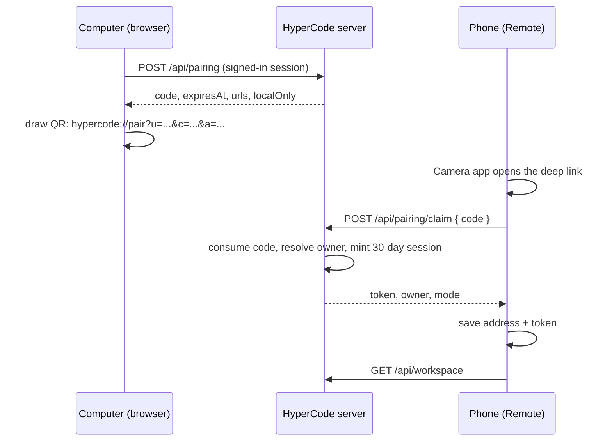

# Pairing a phone with a computer

HyperCode Remote is a companion, not a second workspace. The phone should join the computer
that is already running the workspace, with no address hunting and no access key transcription.

## The problem this replaces

A store build bakes `EXPO_PUBLIC_API_URL` in at build time, and sign-in asks for a long-lived
workspace access key. A person who self-hosts cannot point the app at their computer, cannot see
which address the phone should use, and has no safe way to move the key onto the phone. The
server may also be listening only on `127.0.0.1`, in which case no QR code can make it reachable.

## Principles

1. **One visible action on the computer.** Apps → Connect your phone. No network panel, no key.
2. **The phone scans once.** The QR code carries the address and a short code. The phone opens
   the app and asks for one confirmation.
3. **The code is not the key.** It is random, single-use, bound to the signed-in owner, and
   expires after five minutes. The phone receives its own session.
4. **Both devices open the same workspace.** Chats, tasks, approvals, files and threads are
   shared because the session keeps the computer's owner.
5. **Every dead end explains itself.** Expired code, wrong Wi-Fi, server on localhost, and an
   expired session each have their own copy and next action.

## First pairing



The sheet also shows the grouped code (`K7M2-Q9XP`) and every candidate address for manual entry.
The code and the QR are regenerated automatically when the five minutes run out.

## Returning to the app

The phone stores the computer's origin and session token. On launch it opens the workspace
directly. If the token expired, the connect screen returns with the previous address already
filled in and says why. If the computer is asleep or on another network, the app names the
unreachable address and offers **Try again** and **Connect another computer** instead of looking
connected and failing on every tap.

## Changing devices

- **Phone:** Apps → This device → Disconnect this device. This calls `POST /api/session/logout`
  and deletes the token on the phone, so switching accounts does not leave a live session behind.
- **Computer:** Apps → Connect your phone generates a new code; other paired phones keep working
  until they disconnect or their 30-day session expires. Rotating the server's access key does not
  retroactively revoke issued sessions, and there is no device list yet (follow-up).
- Scanning a QR while already connected opens the confirmation screen and keeps the current
  workspace available through **Back to workspace**.

## Address selection

`POST /api/pairing` chooses addresses in this order:

1. A non-loopback `PUBLIC_API_URL` (a hosted deployment or a tunnel) becomes the only address.
2. Otherwise, if the server binds beyond loopback (`HOST=0.0.0.0`, `::`, or a specific LAN
   address), every non-internal IPv4 address is offered, private home/office ranges first.
3. If the server only listens on loopback, the response is `localOnly: true` with no addresses.
   The sheet then explains the fix: `HOST=0.0.0.0` in live mode, or an HTTPS address in front of
   the server. Sample workspaces are loopback-only by design.

The phone tries the primary address and then the alternates in order. A network failure moves to
the next address; a rejected code does not, because the code is wrong for every address.

## HTTP contract

`POST /api/pairing` — requires `Authorization: Bearer <session>`.

```json
{ "code": "K7M2-Q9XP", "expiresAt": 1760000000000, "urls": [], "localOnly": true }
```

`POST /api/pairing/claim` — no authorization; rate-limited with sign-in.

```json
{ "code": "k7m2 q9xp" }
```

```json
{ "token": "...", "mode": "live", "owner": "u-..." }
```

`POST /api/session/logout` — requires the session's own bearer token. Deletes that one session.

Invalid, expired and already-used codes all return `401` with copy that says to generate a new one.
Only a signed-in computer can mint a code. Codes live in memory, so a server restart invalidates
them; that is acceptable for a five-minute handoff.

## Security notes

- 8 characters from a 32-symbol alphabet (40 bits), single use, five-minute TTL.
- Claim and sign-in share a per-IP limit of 30 attempts per minute.
- The QR never contains `HYPERCODE_ACCESS_KEY`; the token it produces is revoked on disconnect
  and expires after 30 days.
- The token is stored in the app's private documents directory. A future change should move it to
  the platform keychain (`expo-secure-store`).
- Creating a code requires a session, so a visitor who only sees the screen cannot mint one.
- The scan opens a custom `hypercode://` scheme, so a competing app that registers the same scheme
  could intercept it. The code is single-use, so the real app fails visibly instead of leaking the
  workspace, but verified universal links are the stronger follow-up for the store build.

## Follow-ups that make it smoother, in order

1. In-app scanning (`expo-camera`) so the phone does not have to leave the app for its Camera.
2. A paired-device list with **Revoke**, backed by session metadata.
3. Local discovery (`_hypercode._tcp`) so the address can be found without the QR.
4. Handoff: "Continue on phone" from a session, and an activity indicator when the other device is
   viewing the same thread.
5. Push notification when a task needs approval, so the phone does not need to poll.

## Implementation map

- Server: `apps/server/src/pairing.ts`, routes in `apps/server/src/app.ts`.
- Shared app logic: `apps/mobile/src/pairing.ts` (deep-link format and address rules),
  `apps/mobile/src/connect.tsx`, `apps/mobile/src/connection.ts`.
- Computer UI: `apps/mobile/src/pair-phone.tsx` (QR sheet in Apps).
- Phone entry: `App.tsx` (cold-start link, saved connection, expiry fallback).
- Network permissions: `apps/mobile/app.json` carries the iOS local-network description and
  local ATS allowance, and Android cleartext traffic for a LAN `http://` address.
- Tests: `tests/pairing.test.ts`, `apps/mobile/test/pairing.test.ts`.
